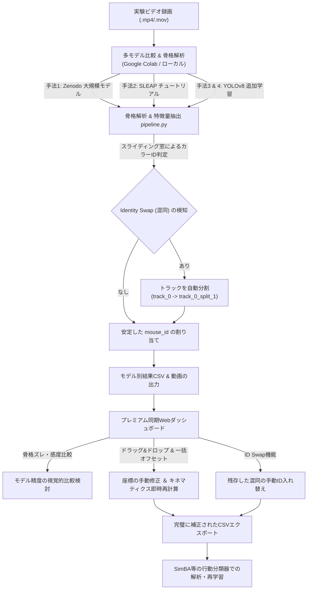

# 🐭 マウスひっかき行動自動検出システム (GUI ＆ 多モデル比較・補正プラットフォーム)

本システムは、集団飼育環境におけるマウスの自動ひっかき行動（Scratch Bout）検出において、トラッキングデータの可視化、個体識別アライメント、骨格姿勢データの手動補正、および異なる姿勢推定モデルの比較検討をシームレスに行うための統合プラットフォームです。

追加パッケージの環境構築なしでローカルでもGoogle Colabでも美しく動作する**プレミアムWebダッシュボード（GUI）**と、マルチアニマルトラッキングにおける最大の課題である「IDの取り違え（混同）」を自動的に防止・分割する**Pythonバックエンドロジック**によって構成されています。

学術研究における高い信頼性と再現性を確保するため、座標補間や物理単位への換算、NaN（欠損値）の厳密な伝搬など、サイエンティフィック・マルチモーダル・データマネジメントに準拠した実装が施されています。

---

## 📸 システムの概要と想定される動き（ワークフロー）

本システムは、実験ビデオの録画から、複数モデルによる比較検討、データ補正、最終解析（SimBA等へのインポート）までの一連の流れ（ワークフロー）を完全にカバーするように設計されています。



### 1. 🔬 4種類の手法による姿勢推定モデルの比較検討（アノテーション完全不要）
本システムでは、自分で1枚もアノテーション（手動ラベル貼り）をすることなく、異なるアプローチのモデルによる解析精度を直接比較検討できます。
1. **【手法1】Zenodo (SuperAnimal-TopViewMouse-5K)**:
   5,000枚のトップダウンマウス画像を用いた学術用大規模データセットをベースにした、極めて頑健なSLEAPモデル。
2. **【手法2】SLEAP公式チュートリアルデータセット (centered_pair)**:
   SLEAP公式が提供する標準的なトップダウン2匹マウス追跡用データセット/モデルテンプレート。
3. **【手法3】Roboflow (sl-h33qa/mouse_poseestimate) モデル**:
   Roboflow Universeで公開されているマウス骨格推定アノテーションデータセットを用いたYOLOv8ポーズモデル。
4. **【手法4】Google Colab上でのYOLOv8-pose超高速ファインチューニング（追加学習）**:
   標準の人間用 `yolov8n-pose.pt` に対し、上記Roboflowの公開アノテーションデータを用いてColabの無料T4 GPUで高速に追加学習を施したカスタムモデル。

### 2. 🛡️ Pythonバックエンド（カラーIDアライメント ＆ 自動分割）
*   **カラーペイント識別**: 各マウスの尾部に塗布された一意のペイント（赤・青・黄・黒）を、OpenCVを用いてフレームごとにHSV色空間で検出します。
*   **混同（Identity Swap）の自動分割**: 2匹のマウスが交差した際にSLEAPのIDが入れ替わってしまった場合、30フレームのスライディング窓が色の遷移を検知し、瞬時にトラックを分割します。

### 3. 🖥️ プレミアム同期Webダッシュボードでの可視化 ＆ 補正
*   **同期デュアルビデオパネル**: 「読み込んだ無加工の元動画（左）」と「骨格マーカー＆尾部ペイントを被せた解析動画（右）」の2面がミリ秒単位で完全に同期してオーバーレイ再生されます。
*   **比較解析結果の動的自動ロード（ドラッグ＆ドロップ不要）**: 
    サーバー内の `outputs/` 配下を自動検出するAPI（`/api/results`）を新設。画面左上の「比較解析結果の自動ロード」ドロップダウンから選択するだけで、異なるアプローチで生成された複数のモデル別CSV結果を瞬時にロードして骨格スケルトンや行動グラフをシームレスに切り替え表示できます。
*   **アノテーションマーカーの手動補正**: Canvas上の関節点をドラッグ＆ドロップしてその場で直感的に修正できます。
*   **バルクオフセット（一括座標補正）**: 複数フレームにまたがるアライメントのズレに対し、X/Y軸の移動量（dx, dy）を指定して「現在フレームのみ」「前方すべてのフレーム」「全フレーム」に一括でオフセットを適用できる強力な補正UIを搭載しています。
*   **手動IDスワッパー (Swap)**: 自動アライメントをすり抜けた微小な個体入れ替わりも、GUI上のIDスワッパーを使って数クリックで一瞬で修正できます。

---

## 📂 プロジェクトのフォルダ構成と各ファイルの役割

本プロジェクトは、フロントエンド（HTML/CSS/JSによる静的SPA）とバックエンド（FastAPIによる解析サーバーおよびPythonデータ処理群）が美しく疎結合に設計されています。

```text
mouse-scratch-dashboard/
├── index.html          # メインGUI：グラスモルフィズムを取り入れたプレミアムSPAダッシュボード
├── index.css           # スタイリング：ダークモード、グラデーション、洗練されたアニメーション定義
├── app.js              # メインロジック：動画同期再生、キーポイント座標の管理、一括補正、API連携
├── charts.js           # グラフ描画：Chart.js を用いたスクラッチ確率・速度メトリクスのリアルタイム描画
├── visualizer.js       # キャンバス描画：HTML5 Canvas を用いた骨格スケルトン・カラーサークルの可視化
├── demoData.js         # デモ用データ：サーバーなしでもブラウザ単体でリッチな動作を検証できる高忠実度データ
├── constants.js        # 共通定数：骨格接続構造（エッジ）やカラーパレット、キーポイントインデックスの定義
│
├── app_server.py       # FastAPI サーバー：静的ファイル配信、結果ファイルリスト化、非同期解析Orchestrator
├── pipeline.py         # 解析パイプライン：動画と骨格データを統合し、ID割り当て・特徴量計算・Bout抽出を実行
├── pose_engine.py      # 姿勢推定エンジン：SLEAP (slp), YOLOv8 (pt), およびモック(Mock)エンジンのラッパー
├── color_id.py         # 個体識別ロジック：HSV空間での色領域検出とスライディング窓による混同検知＆分割
├── feature_extraction.py# キネマティクス抽出：線形補間、物理単位(mm)換算、ルールベースひっかき検出
├── config.py           # 共通設定パラメータ：キーポイント構成、色範囲、ひっかき判定閾値、デフォルトFPS
│
├── test_color_id.py    # 結合テスト：自動 Identity Swap 分割ロジックの動作検証スクリプト
├── test_pose_engine.py # ユニットテスト：エンジンフォールバック、フォーマット変換の品質検証用テスト
├── models/             # モデル保管先：SLEAPの `.slp` や YOLOv8の `.pt` などの重みファイルを配置
└── outputs/            # 解析結果出力先：モデル別、動画別に生成されたCSVや関連データが自動保存される
```

---

## 🔬 サイエンティフィック・データ品質と学術論文向けアプローチ

本システムは、実験室環境でのノイズや遮蔽（オクルージョン）に対応し、論文に耐えうる正確なキネマティクス指標を算出するため、以下のデータクレンジング処理をバックエンドに実装しています。

### 1. 軌跡の欠損に対する線形補間 (Linear Interpolation)
マウスの姿勢推定では、他個体との重なり合いやカメラの死角によって、関節点が一時的に検出漏れ（NaN）になるオクルージョン問題が頻繁に発生します。
*   **アプローチ**: 本システムでは、最大 **5フレーム以内** の一時的な欠損に対して、線形補間を自動的に施して座標を滑らかに復元します。
*   **効果**: 短時間のオクルージョンによる「ひっかき行動の瞬間的な検出途切れ（瞬きノイズ）」を防止し、正確な運動振幅を保ちます。

### 2. NaN（欠損値）の厳密な伝搬と、盲目的ゼロ埋めの排除
多くのナイーブな時系列処理では、欠損値を機械的に `0` で埋めてしまいます（`.fillna(0)`）。しかし、これは物理的な位置座標が突如原点 `(0, 0)` にジャンプしたことを意味し、速度・加速度の計算時に巨大なスパイク（異常値）を発生させます。
*   **アプローチ**: 本システムでは、補間限界（5フレーム）を超える深刻な欠損値に関しては、**NaN（未検出）の状態を厳密に保持して伝搬**させます。
*   **効果**: 座標の欠落しているフレームにおける速度や距離の算出結果も正しく NaN となり、行動分類器に誤った物理量を流し込むのを完全に防止します。

### 3. 実物理単位（mm / mm_s）へのスケーリング
ピクセル座標 `(px)` のみのデータでは、カメラの設置高やズーム倍率によって速度や距離の絶対値が変動してしまい、実験間の比較が困難になります。
*   **アプローチ**: ダッシュボードおよびパイプライン上で「1ピクセルあたりの実寸法（mm/pixel比率）」を設定可能です（デフォルト：`0.25 mm/px`）。
*   **出力メトリクス**:
    *   `body_length_mm`（体長）
    *   `hind_paw_speed_L_mm_s` / `hind_paw_speed_R_mm_s`（左右後肢の秒速 mm/s）
    *   `hind_to_ear_dist_L_mm` / `hind_to_ear_dist_R_mm`（後肢から耳への距離 mm）

---

## ⚙️ MockPoseEngine（インテリジェントフォールバック）について

本システムは、学習済みモデルや実行ライブラリが不足している環境でもダッシュボードの体験やテストができるよう、**MockPoseEngine（ダミーデータ生成器）**への自動フォールバック機能を備えています。

### ⚠️ 「ダミーデータ警告バナー」が表示される条件（モデルがない場合）
以下のいずれかの条件に該当すると、システムは安全のためにMockPoseEngineを起動し、自然な4匹のマウスの軌跡データを擬似生成します。
1.  **SLEAP使用時**: 環境に `sleap-track` コマンドがインストールされていない、または `models/` ディレクトリ内に `.slp` モデルが存在しない場合。
2.  **YOLOv8使用時**: Pythonの `ultralytics` ライブラリがインストールされていない、または動画から骨格キーポイントが1点も検出されなかった場合。
3.  **明示的な指定**: GUIの解析エンジン選択ドロップダウンで `Mock (ダミーデータ)` が明示的に選択された場合。

---

## 🛠️ 技術スタック

*   **フロントエンド**: Vanilla HTML5 (Dual Video, Canvas API), CSS3 (ダークテーマ, グラスモルフィズム, パルスアラート), Chart.js, Lucide Icons
*   **バックエンド**: FastAPI (Uvicorn), OpenCV Python, Pandas, NumPy, h5py, Ultralytics YOLOv8

---

## 🚀 使い方と起動手順

### A. Google Colabでの起動とモデル比較（推奨）
1.  リポジトリ内の [mouse_scratch_dashboard_colab.ipynb](mouse_scratch_dashboard_colab.ipynb) をGoogle Colabで開きます。
2.  Google Driveをマウントし、プロジェクトフォルダをコピーします。
3.  「**ステップ7: 4種類の手法による姿勢推定モデルの構築と一括比較解析**」を実行し、お好みのモデル（Zenodo、SLEAP公式、YOLOv8カスタム等）を自動構築します。
4.  FastAPIサーバーを起動し、発行される `localtunnel` のURLをクリックしてダッシュボードを開きます。
5.  ダッシュボード左上の「**比較解析結果の自動ロード**」ドロップダウンメニューから、各モデルの結果を自由に切り替えてロードし、骨格検出のブレやひっかき判定の精度を視覚的に比較検討します。

### B. ローカルWebサーバーを起動して動作させる場合（フル機能）
Python環境（3.9〜3.11推奨）をお持ちの場合、FastAPIバックエンドサーバーを起動することで、動画解析の実行や自動結果ロードのフル機能を利用できます。

#### 1. 依存パッケージのインストール
超高速パッケージマネージャ [uv](https://github.com/astral-sh/uv) を使用したインストール：
```bash
# uv を使う場合（推奨、数秒で完了します）
uv pip install -r requirements.txt

# 通常の pip を使う場合
pip install -r requirements.txt
```

#### 2. FastAPI バックエンドサーバーの起動
```bash
python app_server.py
```
起動すると、ブラウザで `http://127.0.0.1:8000` にアクセス可能になります。このダッシュボードでは、サーバー上の `outputs/` ディレクトリに保存された解析済みCSVファイルを自動でスキャン・検出して直接ロードできます。

### C. ローカルWebダッシュボードの簡易表示 (インストール・サーバー不要)
1.  Webブラウザでフォルダ内の `index.html` を直接開きます。
2.  高忠実度なシミュレーションデータ（`demoData.js`）が自動でロードされます。
3.  画面左下のインポートパネルに、フレームラベルCSV（例: `*_frame_labels.csv`）と対応する動画ファイル（`.mp4 / .mov` 等）をドラッグ＆ドロップすることで、実動画の上に骨格がオーバーレイした同期再生が開始されます。

---

## 💡 手動補正マニュアル

### 1. マーカー（関節点）の位置をその場で修正する
1.  ダッシュボードの再生コントロールで `Pause`（一時停止）を押します。
2.  Canvas上の修正したいキーポイント（例: `left_hind_paw`）をドラッグ＆ドロップで正しい位置へ移動させます。移動させると、ローリンググラフやキネマティクス特徴量がその場でリアルタイムに再計算されます。

### 2. バルクオフセット（一括座標補正）
1.  カメラ位置のズレなどで骨格全体が一定量ずれている場合、GUI左下の「一括マーカー補正 (Bulk Marker Offset)」パネルを開きます。
2.  補正したいキーポイントを選択し、X移動量（dx）およびY移動量（dy）を入力します。
3.  適用範囲（「現在フレームのみ」「ここから動画の最後まで」「動画の全フレーム」）を選択して `Apply Offset` を実行します。

### 3. 個体IDの取り違え（混同）を手動で修正する
1.  IDが入れ替わってしまった最初のフレームで動画を一時停止します。
2.  左パネルの「個体ID手動入れ替え (Swap ID)」で入れ替え対象の2個体を選択し、`Swap Identities` を実行します。以降のデータが一瞬で入れ替わります。
3.  修正後、右上の `Export Corrected Tracks (CSV)` をクリックして、完璧に補正されたCSVデータをダウンロードし、SimBA等での行動解析に引き渡します。

---

## 🔌 API エンドポイントリファレンス

バックエンドサーバー（`app_server.py`）は、以下の軽量・高性能なREST APIを提供しています。

| メソッド | パス | 説明 |
| :--- | :--- | :--- |
| `GET` | `/` | SPA メインダッシュボード（`index.html`）を返します。 |
| `GET` | `/api/results` | `outputs/` 配下のロード可能な結果CSVファイルの一覧を再帰スキャンして返します。 |
| `POST`| `/api/analyze` | 非同期で解析パイプラインを開始し、タスクIDを即座に発行します。 |
| `GET` | `/api/status/{task_id}` | 指定されたタスクIDのリアルタイムログ、進捗率、結果ファイルのURLを取得します。 |
| `GET` | `/outputs/{filename}` | 生成された結果ファイル（CSV等）を安全にダウンロードさせます。 |
| `GET` | `/{filename}` | ダッシュボードに必要なJavaScript、CSS、検証用動画などの静的ファイルを配信します。 |

---

## 🧪 テストの実行方法

システムの品質とアライメント精度の整合性を担保するため、以下のテストを実行可能です。

#### 1. Identity Swap 自動検出・分割の結合テスト
```bash
python test_color_id.py
```
※赤と青のマウスが50フレーム目に交差（Identity Swap）するシミュレーション動画 `test_swap.mp4` をその場で生成し、スライディング窓によって正しくトラックが自動分割されるかをテストします。

#### 2. 姿勢推定エンジンおよびフォーマット変換のユニットテスト
```bash
python -m unittest test_pose_engine.py
```
※GPU検出の整合性、ロング・ワイドフォーマット変換の正確さ、SLEAP/YOLOv8 が未インストールの環境下で MockPoseEngine へのフォールバックが機能するかを網羅的に検証します。
