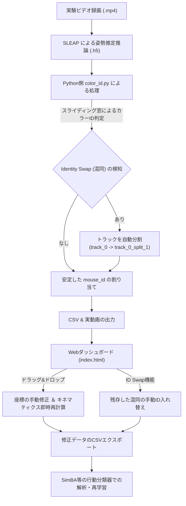

# マウスひっかき行動自動検出システム (GUI & 混同防止トラッキング)

本システムは、集団飼育環境におけるマウスの自動ひっかき行動（Scratch Bout）検出において、トラッキングデータの可視化、個体識別アライメント、および姿勢データの手動補正をシームレスに行うための統合プラットフォームです。

追加パッケージの環境構築なしで動作する**プレミアムWebダッシュボード（GUI）**と、マルチアニマルトラッキングにおける最大の課題である「IDの取り違え（混同）」を自動的に防止・分割する**Pythonバックエンドロジック**によって構成されています。

---

## 📸 システムの概要と想定される動き（ワークフロー）

本システムは、実験開始からデータ補正、最終解析（SimBA等へのインポート）までの一連の流れ（ワークフロー）を完全にカバーするように設計されています。



### 1. Python側でのカラーID割り当て ＆ 自動分割
- **カラーペイント識別**: 各マウスの尾部に塗布された一意のペイント（赤・青・黄・黒）を、OpenCVを用いてフレームごとにHSV色空間で検出します。
- **混同（Identity Swap）の自動分割**: 2匹のマウスが交差した際にSLEAPのIDが入れ替わってしまった場合、30フレームのスライディング窓が色の遷移を検知し、瞬時にトラックを分割します。これにより、別個体の軌跡データが1つのトラックに混ざり合ってしまうのを未然に防ぎます。

### 2. Webダッシュボードでの可視化 ＆ 補正
- **動画オーバーレイ再生**: 前面の Canvas 骨格スケルトンと、背面の `.mp4` 実動画がミリ秒単位で完全に同期してオーバーレイ再生されます。
- **関節マーカーの手動補正**: SLEAPのキーポイントの自動設定がずれている場合、マウスドラッグでその場で簡単に修正できます。修正された座標をもとに、速度や耳間距離といったキネマティクス特徴量がその場でリアルタイムに再計算され、グラフや検出アラートに反映されます。
- **手動ID入れ替え (Swap)**: 自動分割をすり抜けた微小な個体入れ替わりも、GUI上のIDスワッパーを使って数クリックで「指定フレーム以降、最後までIDを入れ替える」ことで一瞬で修正できます。

---

## 🛠️ どのような仕組みとオープンソース（OSS）を使っているか

信頼性が高く軽量なオープンソース技術を厳選して採用し、高いパフォーマンスとメンテナンス性を両立させています。

### 1. フロントエンド（Webダッシュボード）
- **Vanilla HTML5 & CSS3**: 
  - 柔軟な3カラム構成のプレミアムグリッドレイアウトを採用。
  - **グラスモルフィズム（背景ぼかし）**、半透明グラデーション、ひっかき行動検出時の赤い**パルス発光アラートアニメーション**など、モダンで高級感あふれるダークテーマのインターフェースを実現しています。
- **HTML5 Canvas API**:
  - 実動画のサイズや解像度に追従し、11関節キーポイントと骨格スケルトンをスムーズに描画します。
  - ドラッグ＆ドロップ時の座標取得や境界ガード、ドラッグ中のノードの強調表示を制御します。
- **Chart.js (v4.x - MIT License)**:
  - 30フレームのローリング特徴量（後肢速度、耳間距離）のダイナミックな折れ線グラフを描画します。
  - 個体別の Bout 発生回数（棒グラフ）および累積秒数（ドーナツグラフ）を視覚的にレポートします。
- **Lucide Icons (MIT License)**:
  - 美しくクリーンなベクトルアイコンをUI全体に適用しています。

### 2. バックエンド（Pythonツール）
- **OpenCV Python (BSD License)**:
  - ビデオフレームの高速なデコード、尾部周辺（`tail_base`）の切り出し、HSVカラー空間への変換、ガウシアンフィルタによるノイズ除去、および輪郭検出（カラー判定）を行います。
- **Pandas (BSD License)**:
  - SLEAPが出力する高次元なポーズデータを tidy な DataFrame（表形式）として管理し、高速なフィルタリングやグループ化（`groupby`）、トラックの書き換え、時系列データの線形補間処理を行います。
- **NumPy (BSD License)**:
  - 座標計算、ユークリッド距離や速度の配列演算、欠損値（`NaN`）処理などを高速に行います。

---

## 🚀 使い方と起動手順

### A. Webダッシュボードの動かし方 (インストール不要)
1. Webブラウザ（Google Chrome, Microsoft Edge 等）で、以下のフォルダ内にある `index.html` を直接開きます。
   - パス: `C:\Users\goodt\.gemini\antigravity-ide\scratch\mouse-scratch-dashboard\index.html`
2. 起動すると、高忠実度なシミュレーションデータ（`demoData.js`）が自動でロードされます。
3. **ご自身の実験データを読み込む場合**:
   - 画面左下のインポートパネルに、Pythonパイプラインから出力されたフレームラベルCSV（例: `*_frame_labels.csv`）をドラッグ＆ドロップします。
   - 同様に、対応する実験動画（`.mp4` 形式）をドラッグ＆ドロップして読み込ませることで、実動画の上に骨格がオーバーレイした同期再生が開始されます。

### B. Python側での前処理（カラーIDアライメントと自動分割）の動かし方
1. コマンドプロンプトまたは PowerShell を起動します。
2. 作業ディレクトリを `C:\Users\goodt\.gemini\antigravity-ide\scratch\mouse-scratch-dashboard` に変更します。
3. 高速環境マネージャー `uv` を使用して、必要な依存ライブラリを自動ロードしながらパイプラインを起動します。
   ```bash
   # パイプライン全体の実行（動画とSLEAPのH5ファイルを指定）
   uv run --with opencv-python --with pandas --with numpy pipeline.py --video data/videos/cage_01.mp4 --sleap data/sleap/cage_01.h5
   ```
4. **自動分割機能のテスト確認方法**:
   付属の自動テストスクリプトを実行することで、Identity Swap（混同）が発生した際に正しくトラックが自動分割される様子を確認できます。
   ```bash
   uv run --with opencv-python --with pandas --with numpy test_color_id.py
   ```

---

## 💡 手動修正・補正機能の操作マニュアル

### 1. マーカー（関節点）の位置を手動で修正する
1. ダッシュボードの再生コントロールで `Pause`（一時停止）を押します。
2. Canvas上の修正したい関節キーポイント（例: `left_hind_paw`）にマウスカーソルを合わせます。
3. ドラッグ＆ドロップで正しい位置へ移動させます。
4. 移動させると、右側の「リアルタイム特徴量数値」が即座に再計算され、Chart.js のローリンググラフに反映されます。また、もし後肢が耳に接近し、速度が基準を超えた場合、ひっかき行動アラートがその場でトリガーされます。

### 2. 個体IDの取り違え（混同）を手動で修正する
1. 動画を再生し、個体ID（色）が入れ替わってしまった最初のフレーム（例: `345f`）で一時停止します。
2. 画面左側の「個体ID手動入れ替え (Swap ID)」パネルに移動します。
3. 入れ替え対象となる2つの個体（例: `Mouse 1 (赤)` と `Mouse 2 (青)`）を選択します。
4. 開始フレーム（デフォルトで現在のフレームが自動入力されます）を確認し、`Swap Identities` ボタンをクリックします。
5. フレーム 345f から動画の最後まで、2匹のマウスの軌跡データとアノテーションカラーが一瞬で入れ替わります。
6. 修正後、右上の `Export Corrected Tracks (CSV)` をクリックして、完璧に補正されたCSVデータをダウンロードし、SimBA等での行動解析に引き渡します。
