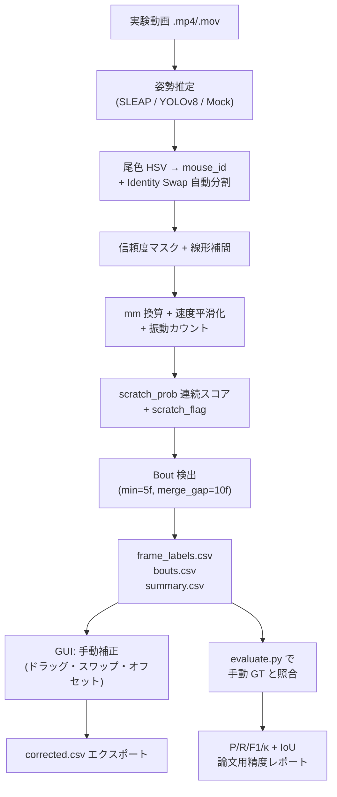

# 🐭 Mouse Scratch Detection System

集団飼育環境下のマウスのひっかき行動（scratch bout）を、姿勢推定 + 物理単位（mm/s, mm）ルールベース判定で自動検出する **学術品質パイプライン** と **インタラクティブ補正ダッシュボード** の統合プラットフォームです。

* **再現可能性**：判定閾値はすべて物理単位（mm/s・mm）、観察時間で正規化された統計量を出力。
* **個体識別**：尾部カラーマーク（赤・青・黄・黒）を HSV 空間で検出し、混同（identity swap）を自動分割。
* **手動補正**：ドラッグ＆ドロップで関節点を補正、IDスワップ、一括オフセット、即時再計算。
* **精度評価**：手動 GT との照合で frame-level（P / R / F1 / Cohen's κ）および bout-level（sensitivity / FDR / temporal IoU）を算出。
* **GUI ↔ バックエンド完全一致**：手動補正後の GUI 再計算と、パイプライン出力の判定ロジックが同一閾値・同一式で完全一致。

> ⚠️ **学術論文として使用する前に必ず読んでください**：本システムのスクラッチ検出は **ルールベースのヒューリスティック** であり、精度は対象動画・カメラ設置条件・個体ごとに変動します。論文化前には必ず **手動アノテーション（グラウンドトゥルース）を `evaluate.py` で照合し、precision / recall / F1 / κ を報告** してください。詳細は [§ 学術利用上の必須事項](#-学術利用上の必須事項) を参照。

---

## 📑 目次
1. [システム概要](#-システム概要)
2. [ワークフロー](#-ワークフロー)
3. [スクラッチ判定アルゴリズム（学術品質）](#-スクラッチ判定アルゴリズム学術品質)
4. [プロジェクト構成](#-プロジェクト構成)
5. [セットアップと起動手順](#-セットアップと起動手順)
6. [使用方法（パイプライン CLI / GUI）](#-使用方法パイプライン-cli--gui)
7. [出力 CSV スキーマ](#-出力-csv-スキーマ)
8. [グラウンドトゥルース評価](#-グラウンドトゥルース評価)
9. [API リファレンス](#-api-リファレンス)
10. [学術利用上の必須事項](#-学術利用上の必須事項)
11. [既知の制約と既知のバグ](#-既知の制約と既知のバグ)
12. [テスト](#-テスト)

---

## 🎯 システム概要

| コンポーネント | 役割 |
| --- | --- |
| **`pipeline.py`** | 動画 → 姿勢推定 → カラー ID 同定 → 特徴量抽出 → スクラッチ判定 → CSV 出力 |
| **`pose_engine.py`** | SLEAP / YOLOv8-pose / MockPoseEngine の抽象化、GPU 自動検出 |
| **`color_id.py`** | 尾色（HSV）スライディング窓投票による個体 ID 割当 + Identity Swap 自動分割 |
| **`feature_extraction.py`** | 信頼度マスキング、線形補間、mm 換算、速度平滑化、振動カウント、scratch_prob 連続スコア |
| **`evaluate.py`** | フレーム / Bout レベルの精度評価（手動 GT との照合） |
| **`app_server.py`** | FastAPI バックエンド（静的配信 + 非同期解析 + 評価 API） |
| **`index.html` / `app.js` / `visualizer.js` / `charts.js`** | プレミアム GUI ダッシュボード（再生・補正・即時再計算・可視化） |

### 主要機能

- **同期デュアル動画パネル**：元動画（左）と骨格オーバーレイ動画（右）をフレーム単位で完全同期再生。
- **ドラッグ＆ドロップ補正**：Canvas 上で関節点をドラッグするとローカル ±15 フレームで mm 単位の判定が即時に再計算される。
- **個体 ID 手動スワップ**：パイプラインで補正しきれなかった混同をフレーム指定で一括入れ替え。
- **バルクオフセット**：複数フレームに渡るカメラズレを X/Y 移動量で一括補正（現在フレーム / 以降 / 全フレーム）。
- **比較解析ローダー**：`outputs/` 配下の複数モデル結果 CSV を 1 クリックで切り替え可視化。
- **補正後 CSV エクスポート**：手動補正済みデータを `evaluate.py` に直接流せるスキーマで出力。

---

## 🔄 ワークフロー



---

## 🧬 スクラッチ判定アルゴリズム（学術品質）

すべての判定は **物理単位（mm/s・mm）** で行い、カメラ間・実験間の比較を可能にします。

### 1. 信頼度マスキング（補間前）

| キーポイント | 閾値 | 環境変数 |
| --- | --- | --- |
| 後肢（`left_hind_paw`, `right_hind_paw`） | `0.35` | `HIND_PAW_MIN_CONF` |
| その他全キーポイント | `0.40` | `MIN_CONFIDENCE` |

閾値未満の座標は **補間前に NaN へマスク**。盲目的ゼロ埋めによる速度スパイクを防止。

### 2. 線形補間

- **最大ギャップ**: `INTERPOLATION_MAX_GAP = 5` フレーム（≈ 167 ms @ 30 fps）
- これを超える深刻な欠損は **NaN を厳密伝搬**（速度・距離も NaN になる）。

### 3. フレーム間速度（mm/s）

```
speed_px_per_frame = sqrt((x_t - x_{t-prev})² + (y_t - y_{t-prev})²) / Δf
speed_mm_s        = speed_px_per_frame × pixel_to_mm_ratio × fps
```

- **欠損フレーム差 (`Δf`) で正規化**：補間限界を超えた区間では速度を NaN とする。
- **移動平均平滑化**：`SCRATCH_VELOCITY_SMOOTH_FRAMES = 5` フレームのローリング平均を判定に使用。

### 4. 振動カウント（最小振幅フィルタ付き）

`SCRATCH_WINDOW_FRAMES = 15` フレームのローリング窓内で **x 軸・y 軸両方** の方向転換回数を数え、`max(osc_x, osc_y)` を採用。

- 振幅 `|d| < SCRATCH_MIN_OSC_AMPLITUDE_PX = 3.0 px` の変位は **姿勢推定ジッタとして無視**。
- 振幅閾値未達時は `last_d` を更新しないため、ノイズによる誤カウントを抑制。

### 5. スクラッチ判定（連続スコア [0, 1]）

| 条件 | 閾値 | 環境変数 |
| --- | --- | --- |
| 平滑化速度 | `> 150 mm/s` | `SCRATCH_MIN_VELOCITY_MM_S` |
| 後肢→耳距離 | `< 50 mm` | `SCRATCH_MAX_HEAD_DIST_MM` |
| 振動数 | `≥ 3` | `SCRATCH_MIN_OSCILLATIONS` |

3 条件すべてを満たした場合、各条件の **超過マージン比** の算術平均で連続スコア `scratch_prob ∈ [0, 1]` を算出：

```python
s_speed = clip((v - v_thresh) / v_thresh, 0, 1)
s_dist  = clip((d_thresh - d) / d_thresh, 0, 1)
s_osc   = clip((osc - osc_thresh) / max(osc_thresh, 1), 0, 1)
scratch_prob = clip((s_speed + s_dist + s_osc) / 3.0, 0, 1)
scratch_flag = 1 if scratch_prob > 0 else 0
```

各成分は閾値のちょうど 2 倍に達したとき 1.0 となる設計です。

### 6. Bout 検出

- `BOUT_MIN_FRAMES = 5` 未満の検出区間は破棄。
- `BOUT_MERGE_GAP = 10` フレーム以内の隣接区間は結合。
- 時刻は **動画から取得した実測 FPS** で計算（環境変数 `DEFAULT_FPS = 30` にフォールバック）。

### 7. 個体別観察時間正規化統計（`*_summary.csv`）

```
mouse_id, observation_duration_s, observation_duration_min,
n_bouts, total_scratch_duration_s,
scratch_rate_bouts_per_min,   ← 個体間比較に推奨
scratch_rate_s_per_min,        ← 個体間比較に推奨
mean_bout_duration_s, sem_bout_duration_s, median_bout_duration_s,
longest_bout_s, fps_used
```

### 🔗 GUI ↔ バックエンド完全一致保証

GUI の `recalculateFrameKinematics()` （手動補正後の即時再計算）と、パイプラインの `feature_extraction.py` は **同一の閾値・同一の式** で動作します（旧 px 基準ロジックは完全削除済み）。`/api/config` 経由でフロントエンドに送信される閾値：

```
SCRATCH_MIN_VELOCITY_MM_S, SCRATCH_MAX_HEAD_DIST_MM,
SCRATCH_MIN_OSCILLATIONS, SCRATCH_MIN_OSC_AMPLITUDE_PX,
SCRATCH_VELOCITY_SMOOTH_FRAMES, SCRATCH_WINDOW_FRAMES,
BOUT_MIN_FRAMES, BOUT_MERGE_GAP, INTERPOLATION_MAX_GAP,
PIXEL_TO_MM_RATIO, DEFAULT_FPS
```

---

## 📂 プロジェクト構成

```text
mouse-scratch-dashboard/
├── index.html              # メイン GUI（SPA ダッシュボード）
├── index.css               # ダークモード・グラデーションスタイル
├── app.js                  # メインロジック（再生・補正・API 連携・mm 基準再計算）
├── visualizer.js           # HTML5 Canvas 骨格描画 + ドラッグ操作
├── charts.js               # Chart.js リアルタイム特徴量グラフ
├── demoData.js             # オフライン動作用デモデータ
├── constants.js            # フロント側共通定数（バックエンド config と同期）
│
├── app_server.py           # FastAPI バックエンド（配信・非同期解析・評価 API）
├── pipeline.py             # End-to-End 解析パイプライン
├── pose_engine.py          # 姿勢推定エンジン（SLEAP / YOLOv8 / DLC SuperAnimal / Mock）
├── color_id.py             # 尾色 HSV → mouse_id + Identity Swap 分割
├── feature_extraction.py   # 信頼度マスク・補間・mm 換算・スクラッチ判定
├── evaluate.py             # フレーム / Bout レベル精度評価
├── config.py               # キーポイント・色定義・全閾値の中央定義
│
├── test_color_id.py        # Identity Swap 分割結合テスト
├── test_pose_engine.py     # エンジン抽象化ユニットテスト
│
├── requirements.txt        # pip 用依存定義
├── environment.yml         # Conda + CUDA 環境定義
├── setup.bat / start.bat   # Windows 環境向け起動スクリプト（start.bat は環境を自動判別・自動構築）
├── check_env.py            # 依存パッケージの検査と不足分の自動インストール（GPU は cu128）
├── setup_models.py         # 事前学習モデル自動取得（Zenodo 等）
│
├── models/                 # 姿勢推定モデル配置先（.slp / .pt）
└── outputs/                # 解析結果出力先（CSV / 評価結果）
```

---

## 🚀 セットアップと起動手順

### A-0. かんたん起動（`start.bat` — 環境を自動構築）

Windows では **`start.bat` をダブルクリックするだけ**で、以下が自動実行される（手動セットアップ不要）。

1. **環境の自動判別**：`conda` があれば conda 環境 `mouse-scratch`、無ければプロジェクト直下の `.venv` を使用。環境が無ければ自動作成する。
2. **依存の自動インストール**：`check_env.py` が不足パッケージを検査して導入する。
   GPU（`nvidia-smi` 検出時）は PyTorch を **cu128** ホイールで入れる（RTX 5080 / sm_120 対応）。DeepLabCut も含め不足分は自動導入。初回は数 GB のダウンロードが発生する。
3. **サーバー起動**：`app_server.py` を起動し、ブラウザで `http://127.0.0.1:8000` を自動で開く。

> 依存の検査・導入だけを単体で行いたい場合：
> ```bat
> python check_env.py            :: 不足分を自動インストール
> python check_env.py --no-install :: 検査・報告のみ（導入しない）
> python check_env.py --skip-dlc   :: DeepLabCut をスキップして軽量導入
> ```

### A. ローカル（GPU 推奨・手動セットアップ）

```bash
# 1. リポジトリ取得
cd mouse-scratch-dashboard

# 2-a. Conda（GPU 環境）
conda env create -f environment.yml
conda activate mouse-scratch

# 2-b. pip（CPU / Colab）
pip install -r requirements.txt
# PyTorch は別途インストール（CUDA バージョンに応じて）:
#   GPU:  pip install torch torchvision --index-url https://download.pytorch.org/whl/cu121
#   CPU:  pip install torch torchvision --index-url https://download.pytorch.org/whl/cpu

# 2-c. (オプション) DeepLabCut SuperAnimal を使う場合
#   → 追加学習不要でマウス専用モデルを zero-shot 利用可能
pip install 'deeplabcut[modelzoo,pytorch]>=3.0.0'

# 3. FastAPI サーバー起動
python app_server.py
# → http://127.0.0.1:8000 でダッシュボードが開く
```

### A-2. Anaconda Prompt から手動起動（`start.bat` を使わない場合）

`start.bat` をダブルクリックする代わりに、**Anaconda Prompt** を開いて手動でサーバー／パイプラインを起動する手順。
スタートメニュー →「Anaconda Prompt」を開き、以下を順に実行する。

```bat
:: 1. プロジェクトフォルダへ移動（/d はドライブをまたぐ場合に必要）
cd /d "C:\path\to\mouse-scratch-dashboard"

:: 2. 仮想環境を有効化
::   2-a. このマシンの動作環境（RTX 5080 対応・PyTorch cu128 入り venv）【推奨】
.venv\Scripts\activate
::   2-b. もしくは conda 環境を使う場合
::   conda activate mouse-scratch

:: 3. 文字コードを UTF-8 に固定（Windows の既定 cp932 だと日本語ログで
::    UnicodeEncodeError が起き、解析が Mock に誤フォールバックすることがある）
set PYTHONUTF8=1

:: 3.5 依存パッケージを検査し、不足があれば自動インストール（任意・初回推奨）
python check_env.py

:: 4-a. ダッシュボード（FastAPI サーバー）を起動
python app_server.py
::    → ブラウザで http://127.0.0.1:8000 を開く（停止は Ctrl+C）

:: 4-b. もしくは解析パイプラインを CLI 実行（GPU・DLC の例）
python pipeline.py --video "C:\path\to\videos\cage_01.mov" ^
    --engine dlc --dlc-superanimal superanimal_topviewmouse ^
    --mice-count 4 --px-to-mm 0.38 --device cuda --out_dir outputs
```

> **環境に関する注意（重要）**
> - 本マシンで GPU 推論が実際に動作するのは **プロジェクト直下の `.venv`**（Python 3.10 / `torch 2.11.0+cu128`）です。RTX 5080（Blackwell / sm_120）は CUDA 12.8 以降のビルドが必要なため、`environment.yml` の `pytorch-cuda=12.1` で作る conda 環境 `mouse-scratch` では GPU カーネルが無く動作しません。
> - GPU を使う場合は上記 **2-a の `.venv`** を有効化してください。`start.bat` は conda 環境を前提にしているため、GPU 解析を行う本環境では本節の手動起動を推奨します。

### B. Google Colab

`mouse_scratch_dashboard_colab.ipynb` を Colab で開き、Drive マウント → セルを順に実行 → `localtunnel` の URL からダッシュボードにアクセス。
ステップ11 で **DeepLabCut SuperAnimal** （追加学習不要のマウス専用モデル）を 1 セル実行で導入できます。

### C. インストール不要のオフライン GUI 体験

`index.html` をブラウザで直接開くだけでデモデータがロードされ、フル機能を操作できます（解析パイプラインは非実行）。

---

## 🛠️ 使用方法（パイプライン CLI / GUI）

### CLI でパイプラインを実行

```bash
python pipeline.py \
    --video data/videos/cage_01.mp4 \
    --engine yolov8 \
    --model_path models/mouse_pose_v2.pt \
    --px-to-mm 0.231 \              # ← 実測校正値（後述）
    --fps 30 \
    --out_dir outputs \
    --gt data/gt/cage_01_gt.csv \   # ← 任意：精度評価
    --gt-format frame \
    --iou 0.5
```

#### DeepLabCut SuperAnimal を使う（追加学習不要・マウス専用）

```bash
# 真上視点 (top-view) — 27 点骨格 (paws は shoulder/hip で近似)
python pipeline.py \
    --video data/videos/cage_01.mp4 \
    --engine dlc \
    --dlc-superanimal superanimal_topviewmouse \
    --px-to-mm 0.231 \
    --out_dir outputs/dlc_topview

# 側面/斜め視点 — 39 点骨格 (paws を直接含む・解剖学的に最適)
python pipeline.py \
    --video data/videos/cage_side.mp4 \
    --engine dlc \
    --dlc-superanimal superanimal_quadruped \
    --px-to-mm 0.231 \
    --out_dir outputs/dlc_quadruped

# 自分で学習したカスタム DLC プロジェクトを使う
python pipeline.py \
    --video data/videos/cage_01.mp4 \
    --engine dlc \
    --model_path /path/to/my_dlc_project/config.yaml \
    --px-to-mm 0.231 \
    --out_dir outputs/dlc_custom
```

| `--dlc-superanimal` 値 | キーポイント数 | 視点 | 含まれる解剖学的特徴 |
|------------------------|--------------|------|----------------------|
| `superanimal_topviewmouse` (デフォルト) | 27 | 真上 | nose, ears, shoulders, hips, tail (**paws なし → shoulder/hip で近似**) |
| `superanimal_quadruped` | 39 | 側面 | nose, ears, **paws (4 足全て)**, joints, tail |

出力（`outputs/cage_01_*.csv`）：
- `cage_01_frame_labels.csv`：フレーム単位の全特徴量＋ scratch_flag / scratch_prob
- `cage_01_bouts.csv`：Bout 単位の集計
- `cage_01_summary.csv`：個体別観察時間正規化統計
- `cage_01_columns.csv`：上記 CSV の列定義（単位・意味・算出式のデータ辞書）

### GUI から実行

1. ダッシュボードを開く → 動画ファイルをドロップ
2. 「解析エンジン」（SLEAP / YOLOv8 / **DLC SuperAnimal (TopView / Quadruped)** / Mock）と pixel→mm 比を設定
3. 「解析パイプラインを実行」をクリック → 非同期実行 → 完了後自動ロード

### 手動補正手順

| 操作 | 用途 |
| --- | --- |
| Canvas 上でキーポイントをドラッグ | 姿勢推定エラーをその場で修正、±15 フレームで mm 判定が即時再計算 |
| **個体 ID 手動入れ替え** | パイプラインで補正しきれなかった混同を任意フレーム以降で一括スワップ |
| **バルクオフセット** | カメラズレ等で骨格全体が一定量ずれている場合の dx/dy 一括補正 |
| **Export Corrected Tracks (CSV)** | バックエンド再評価互換スキーマで補正後データをダウンロード |

---

## 📊 出力 CSV スキーマ

### `*_frame_labels.csv`

```
frame_idx, track, mouse_id,
scratch_flag, scratch_prob, scratch_prob_L, scratch_prob_R,
<11 キーポイント> × {_x, _y, _conf},
# px 系
body_length_px, head_to_nose_dist,
hind_to_head_dist_L, hind_to_head_dist_R,
hind_to_ear_dist_L,  hind_to_ear_dist_R,
hind_paw_speed_L,    hind_paw_speed_R,
hind_osc_x_L, hind_osc_y_L, hind_osc_x_R, hind_osc_y_R,
# mm 系（学術論文用）
body_length_mm, head_to_nose_dist_mm,
hind_to_head_dist_L_mm, hind_to_head_dist_R_mm,
hind_to_ear_dist_L_mm,  hind_to_ear_dist_R_mm,
hind_paw_speed_L_mm_s,  hind_paw_speed_R_mm_s,
hind_paw_speed_L_mm_s_smooth, hind_paw_speed_R_mm_s_smooth,
is_mock
```

### `*_bouts.csv`

検出された個々のスクラッチ bout（連続したひっかき動作のまとまり）の明細。

```
mouse_id, bout_id, bout_start_frame, bout_end_frame,
bout_start_time_s, bout_end_time_s, bout_duration_s,
bout_n_frames, fps_used
```

### `*_summary.csv`

個体ごとに観察時間で正規化した集計値。主要列の意味（§ スクラッチ判定アルゴリズム / 7 も参照）：

| 列名 | 単位 | 意味 | 算出式 |
|---|---|---|---|
| `n_bouts` | 回 | ひっかきエピソードの検出回数（bout 数） | その個体の bout 件数 |
| `total_scratch_duration_s` | 秒 | 実際にひっかいていた総時間 | Σ `bout_duration_s` |
| `scratch_rate_bouts_per_min` | 回/分 | **ひっかき頻度**（個体間比較に推奨） | `n_bouts` ÷ 観察時間(分) |
| `scratch_rate_s_per_min` | 秒/分 | **ひっかき強度**（個体間比較に推奨） | `total_scratch_duration_s` ÷ 観察時間(分) |
| `mean_bout_duration_s` | 秒 | 1 回の bout の平均持続時間 | `mean(bout_duration_s)` |
| `sem_bout_duration_s` | 秒 | bout 持続時間の標準誤差 | `std / sqrt(n_bouts)` |
| `median_bout_duration_s` | 秒 | bout 持続時間の中央値 | `median(bout_duration_s)` |
| `longest_bout_s` | 秒 | 最長 bout の持続時間 | `max(bout_duration_s)` |

### `*_columns.csv`（データ辞書 / 列定義）

解析実行ごとに自動出力される**サイドカー CSV**。`*_summary.csv` と `*_bouts.csv` の全列について
**列名・単位・意味・算出式**を日本語で記載する（UTF-8 BOM 付きで Excel 文字化けなし）。

- データ本体 CSV のスキーマは機械可読性を保つため変更せず、説明は本サイドカーに分離する設計。
- 定義の実体は `pipeline.py` の `COLUMN_DEFINITIONS` / `write_column_definitions()`。
  特徴量・判定ロジックを変更した際は、本辞書も `feature_extraction.py` と厳密に一致させて同時更新すること。

### GUI からの `corrected_tracks_<日付>.csv`

`evaluate.py` 互換スキーマ（`is_scratch` + `scratch_flag` の両カラム、mm 系特徴量付き）。

---

## 🎯 グラウンドトゥルース評価

### GT CSV フォーマット

**Frame フォーマット**（推奨）：
```csv
frame_idx,mouse_id,is_scratch
0,1,0
1,1,0
...
123,1,1
```

**Bout フォーマット**：
```csv
mouse_id,start_frame,end_frame
1,123,189
```

### 評価実行

```bash
python evaluate.py \
    --auto  outputs/cage_01_frame_labels.csv \
    --gt    data/gt/cage_01_gt.csv \
    --format frame \
    --fps 30 \
    --iou 0.5 \
    --out_dir outputs
```

出力：
- `*_eval_frame.csv`：個体別 frame-level Precision / Recall / F1 / **Cohen's κ** / TP / FP / FN / TN
- `*_eval_bout.csv`：個体別 bout-level Sensitivity / FDR / Precision_bout / F1_bout（temporal IoU ≥ 0.5）

---

## 🔌 API リファレンス

| メソッド | パス | 説明 |
| :--- | :--- | :--- |
| `GET`  | `/` | SPA ダッシュボードを返す |
| `GET`  | `/api/config` | バックエンドの全閾値（mm 単位 + bout + 補間 + FPS）をフロントへ送信 |
| `GET`  | `/api/results` | `outputs/` 配下の結果 CSV 一覧を再帰スキャン |
| `POST` | `/api/analyze` | 非同期で解析パイプラインを起動。`task_id` を発行 |
| `GET`  | `/api/status/{task_id}` | 進捗・ログ・結果 URL を取得 |
| `POST` | `/api/evaluate` | サーバー上で `evaluate.py` を実行し精度指標を返す |
| `GET`  | `/outputs/{filename}` | 結果ファイル（CSV）の配信 |
| `GET`  | `/{filename}` | 静的ファイル（JS / CSS / 動画）の配信 |

---

## 🎓 学術利用上の必須事項

### ✅ 論文化前に必ず実施

1. **手動アノテーションとの照合（必須）**
   本システムのスクラッチ検出は **ヒューリスティック** であり、SOTA 機械学習モデルではありません。論文に使用する前に、対象実験動画の **手動アノテーション（最低 30 分 / マウス推奨）** を作成し、`evaluate.py` で frame-level **Precision / Recall / F1 / Cohen's κ** および bout-level **Sensitivity / FDR / F1（temporal IoU ≥ 0.5）** を必ず報告してください。

2. **PIXEL_TO_MM_RATIO のカメラ別実測校正（必須）**
   デフォルト値 `0.25 mm/px` は仮の値です。各カメラ設置位置で **物差し・キャリブレーション物体を撮影し、ピクセル距離 ÷ 既知の実距離 mm** から実測値を算出して `--px-to-mm <値>` で指定してください。未校正だと **mm/s 速度・mm 距離の絶対値は無意味** となり、実験間比較に使えません。デフォルト値使用時はパイプラインが警告を出力します。

3. **マウス専用学習モデルの使用（強く推奨）**
   `Yolov8PoseEngine` は 17 点（COCO 人間用）モデルも動作しますが、`nose=0` を `nose` と `head_center` 両方に流用する近似マッピングのため、距離特徴量（`head_to_nose_dist` 等）が退化します。マウス専用のキーポイントを得るには、次のいずれかを使用してください：

   - **(推奨・最も簡単)** `--engine dlc --dlc-superanimal superanimal_topviewmouse` または `superanimal_quadruped` — DeepLabCut Model Zoo の公開マウスモデルを **追加学習なし (zero-shot)** で使用。Quadruped は paws を直接含むためひっかき検出で解剖学的に最適。
   - SLEAP で自分の動画にラベリングして学習したカスタムモデル（最高精度・要 50〜200 フレームの手動ラベリング）。
   - カスタム YOLOv8-pose の 11 点学習モデル（Roboflow データセット等で fine-tune）。

4. **MockPoseEngine データの完全除外**
   `is_mock=1` のフレームを含む CSV は論文用途では破棄してください。GUI にも赤色警告バンドが表示されます。

5. **FPS の実測値使用**
   パイプラインは動画から FPS を自動取得しますが、可変フレームレート（VFR）動画の場合は `ffmpeg -i input.mp4` で実測 FPS を確認し `--fps <値>` で指定してください。

### 📐 推奨報告事項（論文 Methods 節）

> Pose estimation was performed using SLEAP (Pereira et al., 2022) [or YOLOv8-pose; cite Jocher et al.] with a custom model trained on N annotated frames of laboratory mice in top-down view. Individual identity was assigned via colored tail-paint (red, blue, yellow, black) tracked by HSV-based sliding-window voting over 30 frames, with automatic track splitting upon identity-swap detection. Scratching bouts were detected by a three-condition rule: smoothed hind-paw speed > 150 mm/s (averaged over 5 frames), hind-paw-to-ear distance < 50 mm, and ≥ 3 directional reversals (minimum oscillation amplitude 3 px) within a 15-frame window. Pixel-to-mm calibration was performed per camera at 0.XXX mm/px (measured against a reference ruler at the cage floor). Bouts shorter than 5 frames were discarded; adjacent bouts within 10 frames were merged. Inter-rater reliability against manual annotation was Cohen's κ = X.XX (frame-level), with Sensitivity X.XX / FDR X.XX at temporal IoU ≥ 0.5 (bout-level).

---

## ⚠️ 既知の制約と既知のバグ

| 項目 | 影響 | 回避策 |
| --- | --- | --- |
| **ルールベースの普遍性なし** | スクラッチ閾値は野生型成体マウス向けに調整。仔マウス / 病態モデル / 異なる撮影条件では再調整が必要 | `config.py` の閾値を実験条件ごとに調整し、必ず GT 評価で確認 |
| **尾色 ID の黒色** | HSV V ≤ 40 はケージの影と混同しやすい。集団飼育＋尾遮蔽で頻発 | 黒以外（赤・青・黄）の 3 色＋未着色（白マウス）構成を推奨。または近赤外マーカー使用 |
| **HSV 範囲はカメラ依存** | 照明条件が変わると識別精度が落ちる | 照明条件ごとに `MOUSE_COLORS` を再キャリブレート |
| **PIXEL_TO_MM_RATIO 未校正** | mm/s・mm の絶対値が無意味になる | カメラ設置ごとに必ず実測（§学術利用上の必須事項 / 2） |
| **VFR 動画** | 可変フレームレート動画では時刻が不正確になる | `ffmpeg` で固定フレームレートに再エンコード推奨 |
| **2D 距離のみ** | 高さ方向の動きを捉えられない（top-down 想定） | 真上から撮影、または mm ratio をケージ床面で校正 |
| **頭部直撃以外のスクラッチ** | `hind_to_ear_dist < 50 mm` 条件は耳周辺特化。背中などのスクラッチは非対応 | 別の閾値設計（`hind_to_<target>_dist`）が必要 |

---

## 🧪 テスト

```bash
# Identity Swap 自動分割の結合テスト（test_swap.mp4 を自動生成）
python test_color_id.py

# 姿勢推定エンジン抽象化のユニットテスト
python -m unittest test_pose_engine.py

# 全パイプラインの E2E スモークテスト（任意の動画で）
python pipeline.py --video test_swap.mp4 --engine mock --out_dir outputs/_smoke
```

---

## 📝 ライセンス / 引用

研究で本システムを使用された場合は、リポジトリと共に以下の上流ツールを引用してください：

- SLEAP: Pereira et al., *Nat. Methods* (2022)
- YOLOv8: Jocher et al., Ultralytics (2023)
- OpenCV: Bradski, *Dr. Dobb's J.* (2000)

本リポジトリは MIT ライセンスで公開予定です（執筆時点では未確定）。
